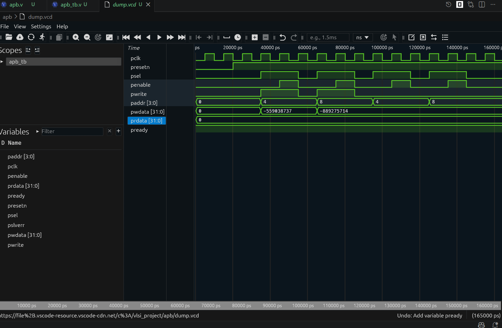

# AMBA APB Slave Controller & Verification Suite

## Overview
A synthesizable Verilog implementation of an ARM AMBA Advanced Peripheral Bus (APB) Slave Controller. The module incorporates a deterministic 3-state Finite State Machine (`IDLE`, `SETUP`, `ACCESS`) interfacing with a 16-word x 32-bit register bank with zero-wait-state handshakes.

## Design Specifications
* **Protocol:** ARM AMBA APB Specification
* **FSM States:** `IDLE` (2'b00) -> `SETUP` (2'b01) -> `ACCESS` (2'b10)
* **Datapath:** 32-bit Data (`pwdata`/`prdata`), 4-bit Address (`paddr`)
* **Handshake Control:** Manages `PSEL`, `PENABLE`, `PWRITE`, and `PREADY`
* **EDA Tools:** Icarus Verilog (`iverilog`), GTKWave / WaveTrace VCD Inspector

## Simulation Waveform

## Verification Plan
1. **Reset Check:** Active-low reset (`presetn`) initializes memory array to zero.
2. **Back-to-Back Writes:** Writes `32'hDEADBEEF` to `4'h4` and `32'hCAFEBABE` to `4'h8`.
3. **Read Verification:** Validates `prdata` output matches written memory values across protocol setup and access phases.